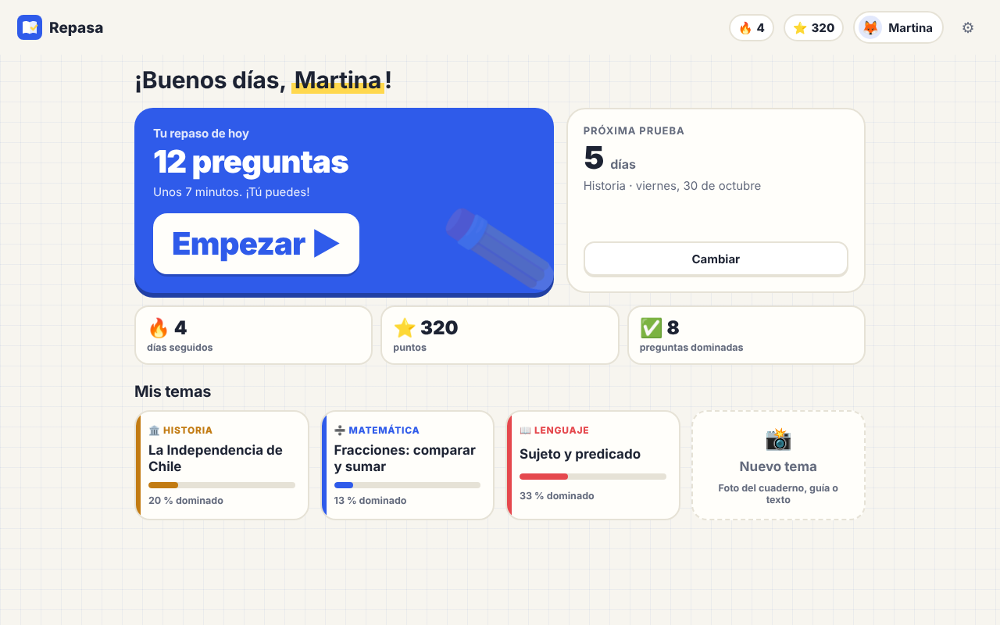
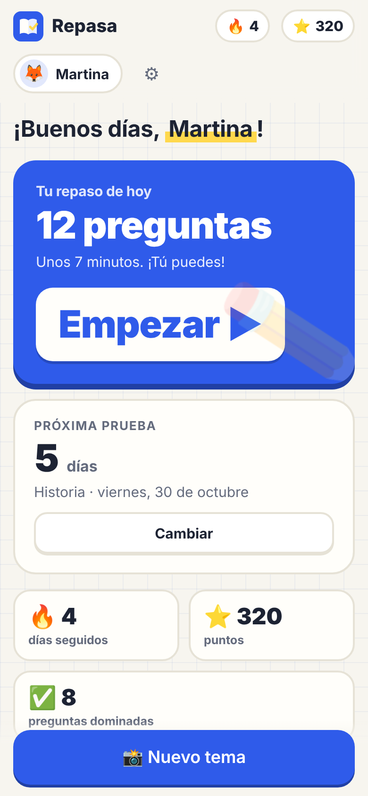
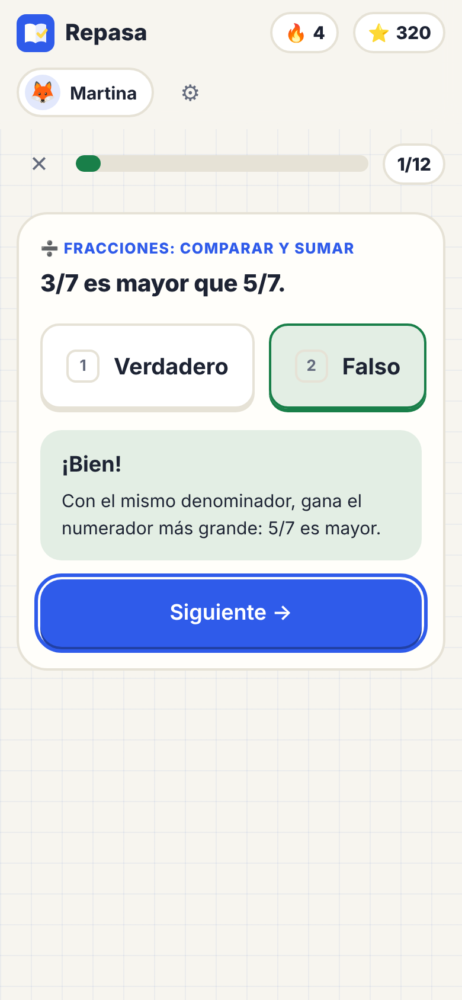

<p align="center"></p>

<h1 align="center">Repasa</h1>

<p align="center"><b>Estudiar con lo que pasan en el colegio, de 5° básico a 4° medio.</b><br>
Le sacas una foto al cuaderno y Repasa arma un resumen fácil, preguntas tipo prueba y tarjetas para memorizar.<br>
Las preguntas que cuestan vuelven hasta que se aprenden. Gratis, de código abierto y sin cuentas.</p>

<p align="center"><a href="https://repasa-app.github.io/repasa/"><b>Página</b></a> ·
<a href="https://repasa-app.github.io/repasa/demo/"><b>Pruébala en el navegador</b></a> ·
<a href="#instalar">Instalar</a> ·
<a href="https://github.com/repasa-app/repasa/discussions">Comunidad</a> ·
<a href="#como-aportar">Cómo aportar</a> ·
<a href="#english">English</a></p>

<p align="center"><picture><source srcset="docs/img/app-inicio-oscuro.png" media="(prefers-color-scheme: dark)"></picture></p>
<p align="center">
<picture><source srcset="docs/img/app-celular-oscuro.png" media="(prefers-color-scheme: dark)"></picture>
<picture><source srcset="docs/img/app-pregunta-celular-oscuro.png" media="(prefers-color-scheme: dark)"></picture>
</p>
<p align="center"><sub>Datos ficticios. El inicio en el computador y en el celular, y una pregunta respondida.</sub></p>

---

## Qué hace
- **De la foto al repaso:** fotos del cuaderno o de la guía, un PDF o texto pegado. La IA de un adulto de la casa (Claude, ChatGPT o
  Gemini, con su cuenta) arma el resumen, los conceptos, entre 3 y 60 preguntas (alternativas, verdadero o falso, completar) y tarjetas.
  Nada se guarda hasta que la persona revisa que calce con su cuaderno.
- **Repaso de cada día:** unos minutos al día con repetición espaciada (cajas de Leitner): lo que sale bien vuelve en días o semanas,
  lo que cuesta vuelve mañana.
- **Prepara la prueba:** dices la fecha y los temas, y Repasa les da prioridad los días antes.
- **"No entendí":** si una explicación no basta, la IA lo explica de otra forma, con un ejemplo de la vida diaria.
- **Ganas de volver:** puntos, racha de días seguidos y una celebración al terminar. Sin anuncios, sin compras dentro de la app.
- **Para adultos:** cómo le va a cada hijo o hija por ramo y en la semana, qué IA se usa, idioma y apariencia (clara, oscura o como el sistema). Varios perfiles en un mismo computador.
- **En el computador y en el celular:** app de Mac (en pruebas) y app de iPhone y Android con **la IA del propio teléfono**,
  gratis y sin internet. El avance viaja en una copia cifrada con una frase que conoce la familia.
- **Sin IA también se puede:** escribir un tema a mano o elegir uno del catálogo. Español e inglés; lo primero que pregunta es el idioma.

<a id="instalar"></a>
## Instalar

| | Cómo | Estado |
|---|---|---|
| 🌐 **Navegador** | [Vista previa con datos ficticios](https://repasa-app.github.io/repasa/demo/): nada que instalar. | Para mirar cómo funciona |
| 🍎 **Mac** | [Desde el código](#en-el-mac-en-pruebas) con `bash build.sh` (macOS 15, Apple Silicon). | En pruebas; aún sin versión publicada ni firma de Apple |
| 📱 **iPhone y Android** | [Desde el código](movil/README.md), en modo de prueba. Usa la IA del teléfono. | Fase 1, en pruebas; todavía no está en las tiendas |
| 🪟 🐧 **Windows y Linux** | La misma interfaz, en una app de escritorio. | En camino |

En el computador, la IA es la de un adulto de la casa, con su cuenta: Claude Code, Codex (ChatGPT) o Gemini CLI
([cómo instalarla](https://repasa-app.github.io/repasa/ia.html)). En GitHub, **Watch → Custom → Releases** avisa cuando salga la
primera versión para descargar.

## Hecha para niñas y niños
- **Sin cuentas ni correos.** Cada perfil es solo un nombre o apodo, un curso y un personaje.
- **Todo queda en el computador**, en una carpeta con archivos abiertos (JSON). No hay servidores de Repasa, ni publicidad, ni telemetría.
- **La IA es la de un adulto** y solo ve el material que se agrega, el curso (para ajustar el nivel) y las preguntas. Nunca el nombre
  ni el progreso de nadie.
- **Respuestas validadas:** todo lo que viene de la IA o del catálogo se revisa (formato, largo, sin HTML) antes de mostrarse.

<a id="como-aportar"></a>
## Cómo aportar
Repasa es gratis y abierta, y la hacemos entre todos: familias, profes, estudiantes y gente que programa. Casi nada exige programar:
- 📚 **Escribe un tema para el catálogo** (por ejemplo «Fracciones equivalentes, 5° básico»), a mano o con tu IA y revisado por ti.
  Formato en [`temas/README.md`](temas/README.md).
- 🍎 **¿Eres profe?** Revisa que las preguntas y explicaciones estén bien y al nivel del curso.
- 💬 **Conversa** en [Discussions](https://github.com/repasa-app/repasa/discussions): dudas, ideas o cómo la usan en tu casa.
- 🐞 **Cuéntanos qué falla o qué te gustaría** en [issues](https://github.com/repasa-app/repasa/issues/new/choose).
- 🛠️ **Programa, con o sin IA:** [`AGENTS.md`](AGENTS.md) es la guía para personas y para cualquier IA de programación. Empieza por
  [CONTRIBUTING.md](CONTRIBUTING.md).

Al participar aceptas el [código de conducta](CODE_OF_CONDUCT.md). ¿Una falla de seguridad? Avísanos en privado: [SECURITY.md](SECURITY.md).

## Estado
Versión 0.1, recién nacida. Ya funcionan el motor (crear temas con la IA, explicar de nuevo, validar, escribir temas a mano) y la
interfaz completa, que puedes [probar con datos ficticios](https://repasa-app.github.io/repasa/demo/). La **app de Mac** está en
pruebas (abajo); las de Windows y Linux vienen en camino. La app del celular está en su primera fase.

## En el Mac (en pruebas)
Una app normal de Mac (macOS 15 o más nuevo, Mac con Apple Silicon) con la misma interfaz. Trae todo adentro (también Python): no
hay que instalar nada más que la IA de un adulto (Claude Code, Codex o Gemini, [cómo instalarla](https://repasa-app.github.io/repasa/ia.html)).
- **Fotos del cuaderno o PDF:** con «Elegir fotos o PDF» o arrastrándolos a «Nuevo tema».
- **Todo queda en `~/Repasa`** (solo tu cuenta del computador puede abrir esa carpeta). Copia cifrada para llevar el avance al
  celular o a otro computador, la misma que en el teléfono.
- **Actualizaciones** desde «Para adultos»: la app revisa sola y nunca interrumpe a los niños.

Mientras no haya una versión publicada, se arma desde el código en un Mac con las herramientas de línea de comandos de Xcode
(`xcode-select --install`):
```bash
git clone https://github.com/repasa-app/repasa ~/Developer/repasa   # en ~/Developer: ~/repasa chocaría con la carpeta de datos ~/Repasa
cd ~/Developer/repasa && bash build.sh                               # compila e instala en ~/Applications/Repasa.app
```
La primera vez, macOS puede pedir confirmar que quieres abrirla (clic derecho → Abrir): la app va firmada solo en tu Mac, todavía
sin firma de Apple.

## En el celular (fase 1, en pruebas)
Repasa también corre en iPhone y Android, con la misma interfaz y **la IA del propio teléfono**: gratis, privada y sin internet.
Es una primera versión para probar en casa; todavía no está en las tiendas y hay que instalarla desde un computador
([`movil/README.md`](movil/README.md)).

**Qué funciona ya**
- Sacar fotos al cuaderno (o elegirlas de la galería) y que el teléfono lea el texto (Vision en iPhone, ML Kit en Android).
- Armar el tema con la IA del teléfono: **Apple Intelligence** (iOS 26, iPhone 15 Pro o más nuevo, activado en Ajustes) o
  **Gemini Nano** (algunos Android recientes con AICore). Todo lo que responde se valida igual que en el computador.
- Si el teléfono no tiene IA, lo dice claro y deja **escribir el tema a mano** (texto simple) o **elegir uno del catálogo**.
  Nunca pide una llave de API ni una cuenta.
- Repaso diario, pruebas, puntos y racha, «No entendí» (con IA), varios perfiles, español e inglés: lo mismo que en el computador.
- **Copia cifrada** en iCloud Drive o Google Drive: se guarda y se trae a mano, y solo se abre con una frase que conoce la familia
  (nadie más puede leerla, tampoco nosotros). Al traerla se junta con lo que hay; nada se borra.

**Qué falta todavía**
- Que se sincronice sola con esa carpeta cifrada, y que **el computador de la casa haga el trabajo de la IA** cuando el teléfono
  no tiene (con la suscripción del adulto). El formato y el cifrado ya están listos y probados; falta conectarlos.
- Leer PDF en el teléfono.
- App Store y Google Play: por ahora se instala en modo de prueba (en iPhone, con una cuenta gratis de Apple, dura 7 días y se
  renueva desde el computador).
- Las partes nativas (Swift y Kotlin) todavía no se prueban solas en GitHub: cada versión se compila y se prueba a mano en
  teléfonos de verdad.

## Cómo funciona
```
fotos / PDF / texto ──► IA del adulto ──► tema (validado) ──► repaso diario con cajas ──► progreso por perfil
                         (resumen, preguntas, tarjetas)       (+ prioridad antes de una prueba)
```

## Formato de los datos
Todo vive en `~/Repasa/` (en Windows, `C:\Users\<tú>\Repasa`; en el celular, `Repasa/` dentro de los datos de la app). Si lo cambiamos, será de forma compatible y avisando.

| Archivo | Qué guarda |
|---|---|
| `perfiles.json` | `[{"id", "nombre", "curso", "avatar"}]`: solo un nombre o apodo. |
| `temas/<id>/tema.json` | Lo que hay que estudiar. Formato en [`temas/README.md`](temas/README.md). |
| `temas/<id>/material/` | Copias de las fotos o PDF de donde salió el tema. |
| `progreso/<perfil>.json` | `{"puntos", "racha", "ultimo_dia", "preguntas": {"<tema>/<pregunta>": {"caja", "proxima"}}, "sesiones": [...]}` |
| `pruebas.json` | `[{"id", "perfil", "ramo", "temas": [...], "fecha"}]` |
| `.repasa/temporal/` | Las fotos de un tema que todavía no se guarda (en el celular, y en el computador las que se arrastran); se borran al abrir la app. |
| `.repasa/` | Ajustes de la app y temas descargados del catálogo. |

## Desarrollo
Necesitas Python 3 (solo biblioteca estándar) y Node para las pruebas de la interfaz.
```bash
cd ui && python3 -m http.server 8765      # interfaz con datos ficticios: http://localhost:8765 (?idioma=en, ?bienvenida, ?vacio)
python3 bin/crear_tema.py 6b historia "" foto.jpg /tmp/tema.json   # crear un tema con tu IA (no guarda nada)
bash pruebas/correr.sh                    # todas las pruebas
bash build.sh                             # app de Mac (solo en un Mac; ver «En el Mac»)
cd movil && npm ci && npm run sync        # app del celular (luego: npx cap open ios / npx cap open android; ver movil/README.md)
```
Lee [`AGENTS.md`](AGENTS.md) antes de cambiar algo: sirve igual para personas y para tu IA.

## Licencia
[AGPL-3.0](LICENSE). Puedes usar, estudiar, cambiar y compartir Repasa. Si la ofreces como servicio o la distribuyes modificada,
tienes que publicar tu código con la misma licencia.

---

## English
**Repasa** ("review") is a free, open-source study app for kids from 5th to 12th grade, made for the family computer. Snap a photo of
the school notebook or worksheet (or add a PDF or text) and a grown-up's own AI (Claude, ChatGPT or Gemini, with their account) builds
an easy summary, test-style questions and flashcards. Daily spaced-repetition reviews bring back what's hard until it's learned, a test
date makes Repasa prioritize those topics, and points and streaks keep it fun. No accounts, no ads, no servers: everything stays on the
computer in open files. Spanish-first, English included. Licensed under AGPL-3.0.

**On the Mac (testing):** a native app (macOS 15+, Apple Silicon) with everything inside, Python included; add notebook photos or
PDFs with a button or by dragging them in. Until a release is published, build it on a Mac with
`git clone https://github.com/repasa-app/repasa ~/Developer/repasa && cd ~/Developer/repasa && bash build.sh`.

**On the phone (phase 1, testing):** an iPhone and Android app with the same interface and the phone's own AI (Apple
Intelligence or Gemini Nano: free, private, offline). Without on-device AI, topics can be written by hand or picked from the
catalog — never an API key. Encrypted copies to iCloud Drive or Google Drive, opened only with a family passphrase. Not in the
stores yet; build instructions in [`movil/README.md`](movil/README.md).

**Try it** in your browser with made-up data: [live preview](https://repasa-app.github.io/repasa/demo/?idioma=en). Questions,
ideas and topics for the catalog are welcome in [Discussions](https://github.com/repasa-app/repasa/discussions), in English or
Spanish; see [CONTRIBUTING.md](CONTRIBUTING.md).

---

[](https://pieza-app.github.io/pieza/) · Las piezas comunes (tu IA, idiomas, actualizaciones…) viven en [Pieza](https://github.com/pieza-app/pieza).
