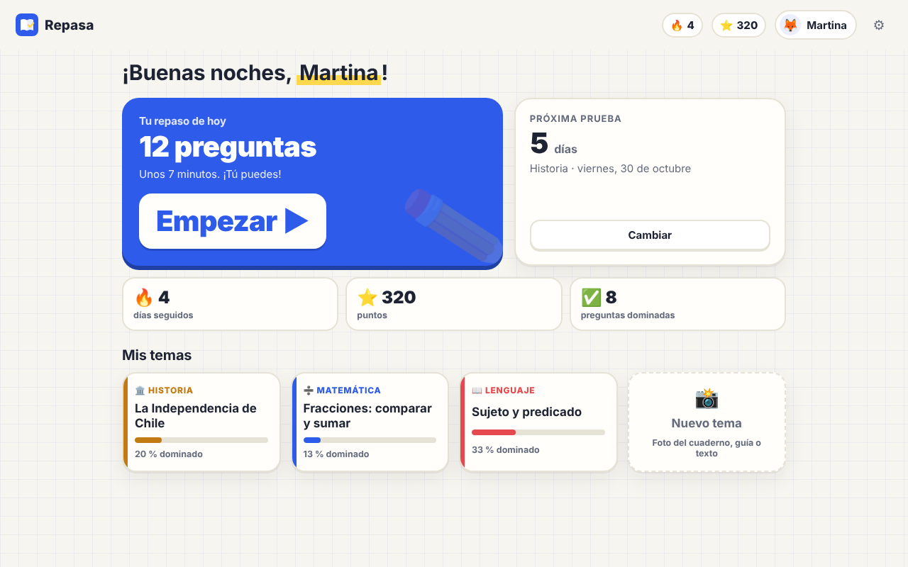
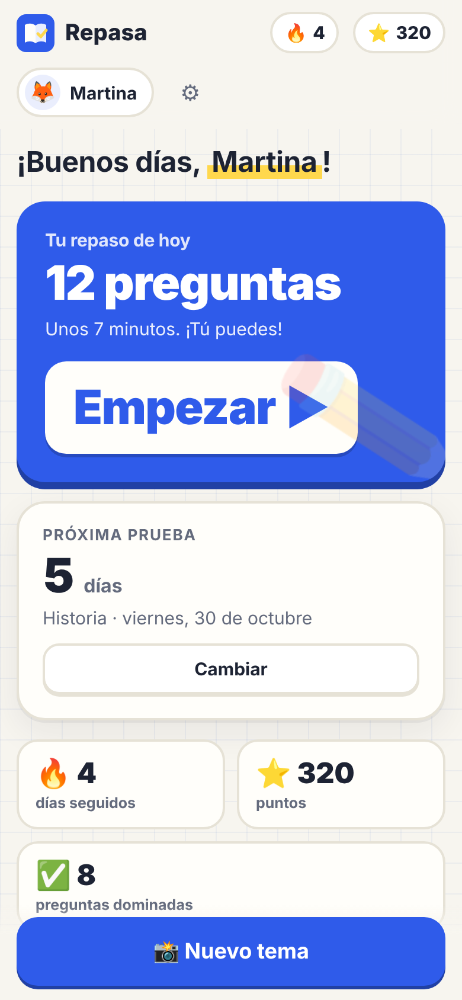
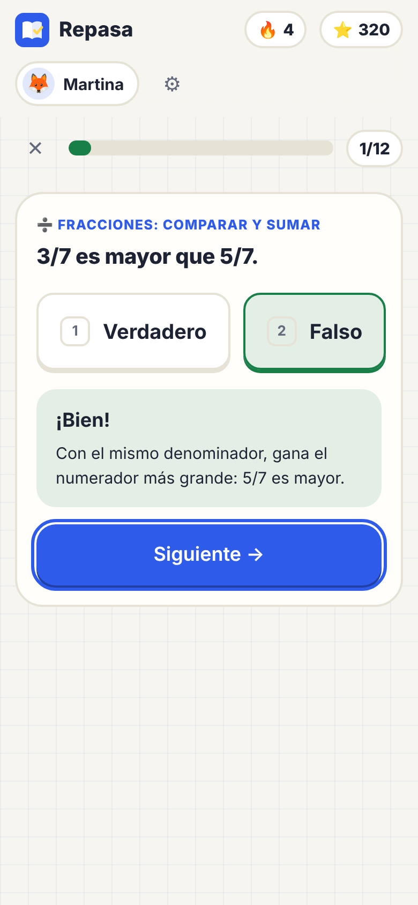

<p align="center"></p>

<h1 align="center">Repasa</h1>

<p align="center"><b>Estudiar con lo que pasan en el colegio, de 5° básico a 4° medio.</b><br>
Le sacas una foto al cuaderno. Repasa arma un resumen fácil, preguntas tipo prueba y tarjetas para memorizar.<br>
Las preguntas difíciles vuelven hasta que se aprenden. Gratis, de código abierto y sin cuentas.</p>

<p align="center"><a href="https://repasa-app.github.io/repasa/"><b>Página</b></a> ·
<a href="https://repasa-app.github.io/repasa/demo/"><b>Pruébala en el navegador</b></a> ·
<a href="#instalar">Instalar</a> ·
<a href="https://github.com/repasa-app/repasa/discussions">Comunidad</a> ·
<a href="https://github.com/repasa-app/repasa/wiki">Wiki</a> ·
<a href="#como-aportar">Cómo aportar</a> ·
<a href="#english">English</a></p>

<p align="center"><picture><source srcset="docs/img/app-inicio-oscuro.png" media="(prefers-color-scheme: dark)"></picture></p>
<p align="center">
<picture><source srcset="docs/img/app-celular-oscuro.png" media="(prefers-color-scheme: dark)"></picture>
<picture><source srcset="docs/img/app-pregunta-celular-oscuro.png" media="(prefers-color-scheme: dark)"></picture>
</p>
<p align="center"><sub>Datos ficticios. El inicio en el computador y en el celular, y una pregunta respondida.</sub></p>

---

## Qué hace
- **De la foto al repaso.** Agrega fotos del cuaderno o de la guía, un PDF o texto pegado. La IA de un adulto de la casa (Claude,
  ChatGPT o Gemini, con su cuenta) arma el tema: el resumen, los conceptos, de 3 a 60 preguntas y las tarjetas. Las preguntas son
  de alternativas, de verdadero o falso o para completar. Nada se guarda hasta que la persona revisa que calza con su cuaderno.
- **El repaso de cada día.** Son unos minutos al día con repetición espaciada (cajas de Leitner). Lo que sale bien vuelve en días o
  semanas. Lo que cuesta vuelve mañana.
- **La preparación de una prueba.** Dices la fecha y los temas. Repasa les da prioridad los días antes.
- **«No entendí».** Si una explicación no basta, la IA la explica de otra forma, con un ejemplo de la vida diaria.
- **Ganas de volver.** Hay puntos, una racha de días seguidos y una celebración al terminar. No hay anuncios ni compras.
- **Para adultos.** Muestra cómo le va a cada hijo o hija, por ramo y en la semana. Ahí se elige la IA, el idioma y la apariencia
  (clara, oscura o como el sistema). Un computador puede tener varios perfiles.
- **En el computador y en el celular.** Hay una app de Mac para descargar. La app de iPhone y Android usa **la IA del propio
  teléfono**: es gratis y no necesita internet. El avance viaja en una copia cifrada, con una frase que conoce la familia.
- **Sin IA también funciona.** Puedes escribir un tema a mano o elegir uno del catálogo.
- **Dos idiomas.** Español e inglés. Lo primero que pregunta la app es el idioma.

<a id="instalar"></a>
## Instalar

| | Cómo | Estado |
|---|---|---|
| 🌐 **Navegador** | [Vista previa con datos ficticios](https://repasa-app.github.io/repasa/demo/). No hay que instalar nada. | Para ver cómo funciona |
| 🍎 **Mac** | [Descargar `Repasa-macOS.zip`](https://github.com/repasa-app/repasa/releases/latest/download/Repasa-macOS.zip) (macOS 15, Apple Silicon). [Pasos abajo](#en-el-mac). | Versión 0.2, todavía sin firma de Apple |
| 📱 **iPhone y Android** | [Desde el código](movil/README.md), en modo de prueba. Usa la IA del teléfono. | Fase 1, en pruebas. Todavía no está en las tiendas |
| 🪟 🐧 **Windows y Linux** | La misma interfaz, en una app de escritorio. | En camino |

En el computador, la IA es la de un adulto de la casa, con su cuenta: Claude Code, Codex (ChatGPT) o Gemini CLI
([cómo instalarla](https://repasa-app.github.io/repasa/ia.html)). Las versiones nuevas del Mac llegan solas desde «Para adultos».
Todas las versiones están en [Releases](https://github.com/repasa-app/repasa/releases).

## Hecha para niñas y niños
- **Sin cuentas ni correos.** Cada perfil es solo un nombre o apodo, un curso y un personaje.
- **Todo queda en el computador**, en una carpeta con archivos abiertos (JSON). Repasa no tiene servidores, publicidad ni telemetría.
- **La IA es la de un adulto.** Solo ve el material que se agrega, el curso (para ajustar el nivel) y las preguntas. Nunca ve el
  nombre ni el progreso de nadie.
- **Respuestas validadas.** Repasa revisa todo lo que viene de la IA o del catálogo (formato, largo, sin HTML) antes de mostrarlo.

<a id="como-aportar"></a>
## Cómo aportar
Repasa es gratis y abierta. La hacemos entre todos: familias, profes, estudiantes y gente que programa. Casi nada exige programar:
- 📚 **Escribe un tema para el catálogo**, por ejemplo «Fracciones equivalentes, 5° básico». Escríbelo a mano o con tu IA, y
  revísalo tú. El formato está en [`temas/README.md`](temas/README.md).
- 🍎 **¿Eres profe?** Revisa que las preguntas y las explicaciones estén bien y al nivel del curso.
- 💬 **Conversa** en [Discussions](https://github.com/repasa-app/repasa/discussions): dudas, ideas o cómo la usan en tu casa.
- 🐞 **Cuéntanos qué falla o qué te gustaría** en [issues](https://github.com/repasa-app/repasa/issues/new/choose).
- 🛠️ **Programa, con o sin IA.** [`AGENTS.md`](AGENTS.md) es la guía para personas y para cualquier IA de programación. Empieza por
  [CONTRIBUTING.md](CONTRIBUTING.md).

Al participar, aceptas el [código de conducta](CODE_OF_CONDUCT.md). ¿Encontraste una falla de seguridad? Avísanos en privado:
[SECURITY.md](SECURITY.md).

## Estado
Repasa está en la versión 0.2. Ya funcionan:
- El motor: crear temas con la IA, explicar de nuevo, validar y escribir temas a mano.
- La interfaz completa. Puedes [probarla con datos ficticios](https://repasa-app.github.io/repasa/demo/).
- La **app de Mac**: ya se [descarga](#en-el-mac). Todavía no tiene firma de Apple.

Las apps de Windows y Linux vienen en camino. La app del celular está en su primera fase.

<a id="en-el-mac"></a>
## En el Mac
Es una app normal de Mac (macOS 15 o más nuevo, con Apple Silicon), con la misma interfaz. Está hecha con Rust y Tauri. Trae todo
adentro, también Python. Solo falta instalar la IA de un adulto (Claude Code, Codex o Gemini,
[cómo instalarla](https://repasa-app.github.io/repasa/ia.html)).
- **Fotos del cuaderno o PDF:** usa «Elegir fotos o PDF» o arrástralos a «Nuevo tema».
- **Todo queda en `~/Repasa`.** Solo tu cuenta del computador puede abrir esa carpeta. La copia cifrada lleva el avance al celular o
  a otro computador. Es la misma copia que usa el teléfono.
- **Actualizaciones** desde «Para adultos». La app revisa sola y nunca interrumpe a los niños.

**Instalar:**
1. Descarga [`Repasa-macOS.zip`](https://github.com/repasa-app/repasa/releases/latest/download/Repasa-macOS.zip). Su huella,
   `Repasa-macOS.zip.sha256`, está al lado en [Releases](https://github.com/repasa-app/repasa/releases).
2. Descomprime el archivo.
3. Mueve **Repasa** a Aplicaciones.
4. La primera vez, intenta abrirla. macOS dice que no puede verificarla, porque todavía no tiene firma de Apple.
5. Ve a Ajustes del Sistema → Privacidad y seguridad → «Abrir igualmente».

**Desde el código** (para probar los cambios más nuevos). Necesitas un Mac con [Rust](https://rustup.rs) y las herramientas de
línea de comandos de Xcode (`xcode-select --install`):
```bash
git clone https://github.com/repasa-app/repasa ~/Developer/repasa   # en ~/Developer: ~/repasa chocaría con la carpeta de datos ~/Repasa
cd ~/Developer/repasa && bash build.sh                               # compila e instala en ~/Applications/Repasa.app
```
La app queda firmada solo en tu Mac, sin firma de Apple. Si macOS avisa que no puede verificarla, ábrela desde Ajustes del Sistema →
Privacidad y seguridad → «Abrir igualmente».

## En el celular (fase 1, en pruebas)
Repasa también corre en iPhone y Android, con la misma interfaz y **la IA del propio teléfono**. Es gratis, privada y no necesita
internet. Es una primera versión para probar en casa. Todavía no está en las tiendas: se instala desde un computador
([`movil/README.md`](movil/README.md)).

**Qué funciona ya**
- Sacar fotos al cuaderno o elegirlas de la galería. El teléfono lee el texto (Vision en iPhone, ML Kit en Android).
- Armar el tema con la IA del teléfono: **Apple Intelligence** (iOS 26, iPhone 15 Pro o más nuevo, activado en Ajustes) o
  **Gemini Nano** (algunos Android recientes con AICore). La app valida todo lo que responde, igual que en el computador.
- Si el teléfono no tiene IA, la app lo dice. Entonces deja **escribir el tema a mano** (texto simple) o **elegir uno del catálogo**.
  Nunca pide una llave de API ni una cuenta.
- Lo mismo que en el computador: el repaso diario, las pruebas, los puntos y la racha, «No entendí» (con IA), varios perfiles,
  español e inglés.
- **Copia cifrada** en iCloud Drive o Google Drive. Se guarda y se trae a mano. Solo se abre con una frase que conoce la familia:
  nadie más puede leerla, tampoco nosotros. Al traerla, se junta con lo que hay. Nada se borra.

**Qué falta todavía**
- La sincronización sola con esa carpeta cifrada.
- Que **el computador de la casa haga el trabajo de la IA** cuando el teléfono no tiene IA (con la suscripción del adulto). El
  formato y el cifrado ya están listos y probados. Falta conectarlos.
- Leer PDF en el teléfono.
- La App Store y Google Play. Por ahora se instala en modo de prueba. En iPhone, con una cuenta gratis de Apple, dura 7 días y se
  renueva desde el computador.
- Las pruebas automáticas de las partes nativas (Swift y Kotlin) en GitHub. Hoy cada versión se compila y se prueba a mano en
  teléfonos de verdad.

## Cómo funciona
```
fotos / PDF / texto ──► IA del adulto ──► tema (validado) ──► repaso diario con cajas ──► progreso por perfil
                         (resumen, preguntas, tarjetas)       (+ prioridad antes de una prueba)
```

## Formato de los datos
Todo vive en `~/Repasa/`. En Windows es `C:\Users\<tú>\Repasa`. En el celular es `Repasa/`, dentro de los datos de la app. Si
cambiamos el formato, el cambio es compatible y lo avisamos.

| Archivo | Qué guarda |
|---|---|
| `perfiles.json` | `[{"id", "nombre", "curso", "avatar"}]`: solo un nombre o apodo. |
| `temas/<id>/tema.json` | Lo que hay que estudiar. El formato está en [`temas/README.md`](temas/README.md). |
| `temas/<id>/material/` | Copias de las fotos o del PDF de donde salió el tema. |
| `progreso/<perfil>.json` | `{"puntos", "racha", "ultimo_dia", "preguntas": {"<tema>/<pregunta>": {"caja", "proxima"}}, "sesiones": [...]}` |
| `pruebas.json` | `[{"id", "perfil", "ramo", "temas": [...], "fecha"}]` |
| `.repasa/temporal/` | Las fotos de un tema que todavía no se guarda (en el celular, y en el computador las que se arrastran). Se borran al abrir la app. |
| `.repasa/` | Los ajustes de la app y los temas descargados del catálogo. |

## Desarrollo
Necesitas Python 3 (solo biblioteca estándar), Node para las pruebas de la interfaz y Rust para la app de escritorio.
```bash
cd ui && python3 -m http.server 8765      # interfaz con datos ficticios: http://localhost:8765 (?idioma=en, ?bienvenida, ?vacio)
python3 bin/crear_tema.py 6b historia "" foto.jpg /tmp/tema.json   # crear un tema con tu IA (no guarda nada)
bash pruebas/correr.sh                    # todas las pruebas
cd escritorio && cargo run                # la app de escritorio, en cualquier sistema
bash build.sh                             # la app de Mac instalada (solo en un Mac; ver «En el Mac»)
cd movil && npm ci && npm run sync        # app del celular (luego: npx cap open ios / npx cap open android; ver movil/README.md)
```
Lee [`AGENTS.md`](AGENTS.md) antes de cambiar algo. Sirve igual para personas y para tu IA.

## Licencia
[AGPL-3.0](LICENSE). Puedes usar, estudiar, cambiar y compartir Repasa. Si la ofreces como servicio o la distribuyes modificada,
publica tu código con la misma licencia.

---

## English
**Repasa** ("review") is a free, open-source study app for kids from 5th to 12th grade. It is made for the family computer.
1. Take a photo of the school notebook or worksheet. You can also add a PDF or text.
2. A grown-up's own AI (Claude, ChatGPT or Gemini, with their account) builds an easy summary, test-style questions and flashcards.
3. Daily spaced-repetition reviews bring back the hard questions until the child learns them.

A test date makes Repasa put those topics first. Points and streaks keep it fun. There are no accounts, no ads and no servers:
everything stays on the computer, in open files. Spanish first, English included. License: AGPL-3.0.

**On the Mac:** a native app (macOS 15+, Apple Silicon), built with Rust and Tauri. Everything is inside, Python included. Add
notebook photos or PDFs with a button, or drag them in.
1. [Download `Repasa-macOS.zip`](https://github.com/repasa-app/repasa/releases/latest/download/Repasa-macOS.zip).
2. Unzip it and move Repasa to Applications.
3. The app isn't signed by Apple yet. The first time, try to open it. Then go to System Settings → Privacy & Security →
   «Open Anyway».

New versions arrive from «For grown-ups». To build from source, install [Rust](https://rustup.rs) and run:
`git clone https://github.com/repasa-app/repasa ~/Developer/repasa && cd ~/Developer/repasa && bash build.sh`.

**On the phone (phase 1, testing):** an iPhone and Android app with the same interface. It uses the phone's own AI (Apple
Intelligence or Gemini Nano): free, private and offline. Without on-device AI, you write topics by hand or pick them from the
catalog. The app never asks for an API key. Encrypted copies go to iCloud Drive or Google Drive and open only with a family
passphrase. The app is not in the stores yet. Build instructions are in [`movil/README.md`](movil/README.md).

**Try it** in your browser with made-up data: [live preview](https://repasa-app.github.io/repasa/demo/?idioma=en). Questions,
ideas and topics for the catalog are welcome in [Discussions](https://github.com/repasa-app/repasa/discussions), in English or
Spanish. See [CONTRIBUTING.md](CONTRIBUTING.md).

---

[](https://pieza-app.github.io/pieza/) · Las piezas comunes (tu IA, idiomas, actualizaciones, la app de Mac…) viven en [Pieza](https://github.com/pieza-app/pieza).

[](https://pieza-app.github.io/pieza/) · The shared pieces (your AI, languages, updates, the Mac app…) live in [Pieza](https://github.com/pieza-app/pieza).
